# BPMN symbols

Every BPMN 2.0.2 symbol that tok draws, with the statement that produces it and whether Camunda 8 executes it. The pictures are made by the tok engine itself (`tools/symbols.py` writes them from small models with `tok bpmn` and `tok svg`), so they are exactly what `tok svg` draws in a diagram. The catalogue with the short descriptions in English and Polish is `symbols/symbols.json`.

"Not executed" means that Camunda 8 does not execute the element; `tok check` reports the code given in executable documents (`conformance-camunda.md`). "Modelling only" elements are exported and kept, and the engine ignores them. Groups (`group ID "Label" members="A B"`) are exported as BPMN groups without a shape in the diagram, so they have no symbol here.

## Start events

| Symbol | Element | BPMN | tok | Camunda 8 |
|---|---|---|---|---|
|  | start event | StartEvent | `start ID` | executed |
|  | message start event | StartEvent with message trigger | `start ID message="M"` | executed |
|  | timer start event | StartEvent with timer trigger | `start ID timer=P1D` | executed |
|  | conditional start event | StartEvent with conditional trigger | `start ID condition="x > 1"` | executed in event sub-processes |
|  | signal start event | StartEvent with signal trigger | `start ID signal="S"` | executed |
|  | multiple start event | StartEvent with multiple trigger | `start ID message="A" signal="B"` | not executed (C104) |
|  | parallel multiple start event | StartEvent with parallel multiple trigger | `start ID message="A" message="B" parallel` | not executed (C105) |

## Start events of event sub-processes

| Symbol | Element | BPMN | tok | Camunda 8 |
|---|---|---|---|---|
|  | interrupting message start event of an event sub-process | StartEvent with message trigger in an event sub-process (interrupting) | `eventsub … / start ID message="M"` | executed |
|  | interrupting timer start event of an event sub-process | StartEvent with timer trigger in an event sub-process (interrupting) | `eventsub … / start ID timer=P1D` | executed |
|  | interrupting conditional start event of an event sub-process | StartEvent with conditional trigger in an event sub-process (interrupting) | `eventsub … / start ID condition="x > 1"` | executed |
| 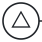 | interrupting signal start event of an event sub-process | StartEvent with signal trigger in an event sub-process (interrupting) | `eventsub … / start ID signal="S"` | executed |
|  | interrupting error start event of an event sub-process | StartEvent with error trigger in an event sub-process (interrupting) | `eventsub … / start ID error="E"` | executed |
|  | interrupting escalation start event of an event sub-process | StartEvent with escalation trigger in an event sub-process (interrupting) | `eventsub … / start ID escalation="X"` | executed |
|  | interrupting compensation start event of an event sub-process | StartEvent with compensation trigger in an event sub-process (interrupting) | `eventsub … / start ID compensate` | executed |
| 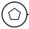 | interrupting multiple start event of an event sub-process | StartEvent with multiple trigger in an event sub-process (interrupting) | `eventsub … / start ID message="A" signal="B"` | not executed (C104) |
|  | interrupting parallel multiple start event of an event sub-process | StartEvent with parallel multiple trigger in an event sub-process (interrupting) | `eventsub … / start ID message="A" message="B" parallel` | not executed (C105) |
|  | non-interrupting message start event of an event sub-process | StartEvent with message trigger in an event sub-process (non-interrupting) | `eventsub … / start ID message="M" noninterrupting` | executed |
|  | non-interrupting timer start event of an event sub-process | StartEvent with timer trigger in an event sub-process (non-interrupting) | `eventsub … / start ID timer=P1D noninterrupting` | executed |
|  | non-interrupting conditional start event of an event sub-process | StartEvent with conditional trigger in an event sub-process (non-interrupting) | `eventsub … / start ID condition="x > 1" noninterrupting` | executed |
| 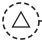 | non-interrupting signal start event of an event sub-process | StartEvent with signal trigger in an event sub-process (non-interrupting) | `eventsub … / start ID signal="S" noninterrupting` | executed |
|  | non-interrupting escalation start event of an event sub-process | StartEvent with escalation trigger in an event sub-process (non-interrupting) | `eventsub … / start ID escalation="X" noninterrupting` | executed |
| 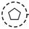 | non-interrupting multiple start event of an event sub-process | StartEvent with multiple trigger in an event sub-process (non-interrupting) | `eventsub … / start ID message="A" signal="B" noninterrupting` | not executed (C104) |
|  | non-interrupting parallel multiple start event of an event sub-process | StartEvent with parallel multiple trigger in an event sub-process (non-interrupting) | `eventsub … / start ID message="A" message="B" parallel noninterrupting` | not executed (C105) |

## Intermediate events

| Symbol | Element | BPMN | tok | Camunda 8 |
|---|---|---|---|---|
|  | catching message intermediate event | IntermediateCatchEvent with message trigger | `catch ID message="M"` | executed |
|  | catching timer intermediate event | IntermediateCatchEvent with timer trigger | `catch ID timer=P1D` | executed |
|  | catching conditional intermediate event | IntermediateCatchEvent with conditional trigger | `catch ID condition="x > 1"` | executed |
| 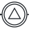 | catching signal intermediate event | IntermediateCatchEvent with signal trigger | `catch ID signal="S"` | executed |
|  | catching multiple intermediate event | IntermediateCatchEvent with multiple trigger | `catch ID message="A" signal="B"` | not executed (C104) |
|  | catching parallel multiple intermediate event | IntermediateCatchEvent with parallel multiple trigger | `catch ID message="A" message="B" parallel` | not executed (C105) |
|  | catching link intermediate event | IntermediateCatchEvent with link trigger | `catch ID link="L"` | executed |
|  | intermediate event (none) | IntermediateThrowEvent | `throw ID` | executed |
|  | throwing message intermediate event | IntermediateThrowEvent with message trigger | `throw ID message="M"` | executed |
|  | throwing signal intermediate event | IntermediateThrowEvent with signal trigger | `throw ID signal="S"` | executed |
|  | throwing escalation intermediate event | IntermediateThrowEvent with escalation trigger | `throw ID escalation="X"` | executed |
|  | throwing compensation intermediate event | IntermediateThrowEvent with compensation trigger | `throw ID compensate` | executed |
|  | throwing multiple intermediate event | IntermediateThrowEvent with multiple trigger | `throw ID message="A" signal="B"` | not executed (C104) |
|  | throwing link intermediate event | IntermediateThrowEvent with link trigger | `throw ID link="L"` | executed |

## Boundary events

| Symbol | Element | BPMN | tok | Camunda 8 |
|---|---|---|---|---|
|  | interrupting message boundary event | BoundaryEvent with message trigger (interrupting) | `boundary ID on=ACTIVITY message="M"` | executed |
| 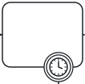 | interrupting timer boundary event | BoundaryEvent with timer trigger (interrupting) | `boundary ID on=ACTIVITY timer=P1D` | executed |
|  | interrupting conditional boundary event | BoundaryEvent with conditional trigger (interrupting) | `boundary ID on=ACTIVITY condition="x > 1"` | executed |
|  | interrupting signal boundary event | BoundaryEvent with signal trigger (interrupting) | `boundary ID on=ACTIVITY signal="S"` | executed |
| 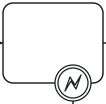 | interrupting error boundary event | BoundaryEvent with error trigger (interrupting) | `boundary ID on=ACTIVITY error="E"` | executed |
| 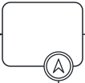 | interrupting escalation boundary event | BoundaryEvent with escalation trigger (interrupting) | `boundary ID on=ACTIVITY escalation="X"` | executed |
|  | interrupting multiple boundary event | BoundaryEvent with multiple trigger (interrupting) | `boundary ID on=ACTIVITY message="A" signal="B"` | not executed (C104) |
| 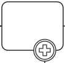 | interrupting parallel multiple boundary event | BoundaryEvent with parallel multiple trigger (interrupting) | `boundary ID on=ACTIVITY message="A" message="B" parallel` | not executed (C105) |
| 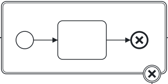 | cancel boundary event | BoundaryEvent with cancel trigger | `boundary ID on=TRANSACTION cancel` | not executed (C101) |
| 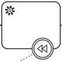 | compensation boundary event | BoundaryEvent with compensation trigger | `service ID compensate=HANDLER` | executed |
|  | non-interrupting message boundary event | BoundaryEvent with message trigger (non-interrupting) | `boundary ID on=ACTIVITY message="M" noninterrupting` | executed |
| 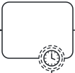 | non-interrupting timer boundary event | BoundaryEvent with timer trigger (non-interrupting) | `boundary ID on=ACTIVITY timer=P1D noninterrupting` | executed |
|  | non-interrupting conditional boundary event | BoundaryEvent with conditional trigger (non-interrupting) | `boundary ID on=ACTIVITY condition="x > 1" noninterrupting` | executed |
| 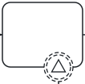 | non-interrupting signal boundary event | BoundaryEvent with signal trigger (non-interrupting) | `boundary ID on=ACTIVITY signal="S" noninterrupting` | executed |
|  | non-interrupting escalation boundary event | BoundaryEvent with escalation trigger (non-interrupting) | `boundary ID on=ACTIVITY escalation="X" noninterrupting` | executed |
| 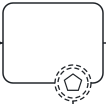 | non-interrupting multiple boundary event | BoundaryEvent with multiple trigger (non-interrupting) | `boundary ID on=ACTIVITY message="A" signal="B" noninterrupting` | not executed (C104) |
|  | non-interrupting parallel multiple boundary event | BoundaryEvent with parallel multiple trigger (non-interrupting) | `boundary ID on=ACTIVITY message="A" message="B" parallel noninterrupting` | not executed (C105) |

## End events

| Symbol | Element | BPMN | tok | Camunda 8 |
|---|---|---|---|---|
|  | end event | EndEvent | `end ID` | executed |
|  | message end event | EndEvent with message trigger | `end ID message="M"` | executed |
|  | error end event | EndEvent with error trigger | `end ID error="E"` | executed |
|  | escalation end event | EndEvent with escalation trigger | `end ID escalation="X"` | executed |
|  | signal end event | EndEvent with signal trigger | `end ID signal="S"` | executed |
|  | compensation end event | EndEvent with compensation trigger | `end ID compensate` | executed |
|  | multiple end event | EndEvent with multiple trigger | `end ID message="A" signal="B"` | not executed (C104) |
|  | cancel end event | EndEvent with cancel trigger | `end ID cancel` | not executed (C101) |
|  | terminate end event | EndEvent with terminate trigger | `end ID terminate` | executed |

## Activities

| Symbol | Element | BPMN | tok | Camunda 8 |
|---|---|---|---|---|
| 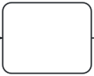 | task | Task | `task ID` | executed |
| 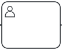 | user task | UserTask | `user ID` | executed |
| 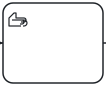 | manual task | ManualTask | `manual ID` | executed |
| 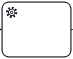 | service task | ServiceTask | `service ID` | executed |
| 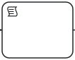 | script task | ScriptTask | `script ID` | executed |
| 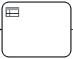 | business rule task | BusinessRuleTask | `rule ID` | executed |
|  | send task | SendTask | `send ID` | executed |
|  | receive task | ReceiveTask | `receive ID` | executed |
| 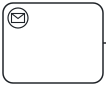 | instantiating receive task | ReceiveTask (instantiate) | `receive ID message="M" instantiate` | not executed (C106) |
| 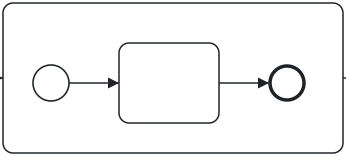 | embedded sub-process | SubProcess | `sub ID (block)` | executed |
| 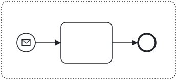 | event sub-process | SubProcess (triggeredByEvent) | `eventsub ID (block)` | executed |
| 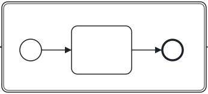 | transaction | Transaction | `transaction ID (block)` | not executed (C100) |
| 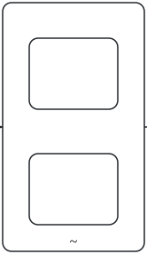 | ad-hoc sub-process | AdHocSubProcess | `adhoc ID (block)` | executed |
| 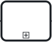 | call activity | CallActivity (process) | `call ID process=P` | executed |
| 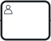 | call activity of a global user task | CallActivity (global task) | `call ID task=GLOBAL` | not executed (C108) |

## Activity markers

| Symbol | Element | BPMN | tok | Camunda 8 |
|---|---|---|---|---|
| 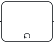 | task with the loop marker | standard loop | `task ID loop` | not executed (C103) |
|  | task with the parallel multi-instance marker | parallel multi-instance | `task ID parallel` | executed |
| 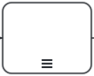 | task with the sequential multi-instance marker | sequential multi-instance | `task ID sequential` | executed |
| 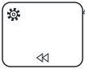 | task with the compensation marker | compensation activity | `service ID compensation` | executed |

## Gateways

| Symbol | Element | BPMN | tok | Camunda 8 |
|---|---|---|---|---|
|  | exclusive gateway | ExclusiveGateway | `xor ID` | executed |
|  | inclusive gateway | InclusiveGateway | `or ID` | executed |
| 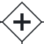 | parallel gateway | ParallelGateway | `and ID` | executed |
|  | complex gateway | ComplexGateway | `complex ID` | not executed (C102) |
| 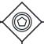 | event-based gateway | EventBasedGateway | `eventgw ID` | executed |
| 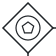 | instantiating exclusive event-based gateway | EventBasedGateway (instantiate) | `eventgw ID instantiate` | not executed (C107) |
| 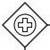 | instantiating parallel event-based gateway | EventBasedGateway (instantiate, parallel) | `eventgw ID instantiate parallel` | not executed (C107) |

## Data

| Symbol | Element | BPMN | tok | Camunda 8 |
|---|---|---|---|---|
|  | data object | DataObjectReference | `data ID` | modelling only |
| 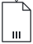 | collection data object | DataObjectReference (collection) | `data ID collection` | modelling only |
|  | data input | DataInput | `input ID` | modelling only |
|  | data output | DataOutput | `output ID` | modelling only |
| 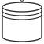 | data store | DataStoreReference | `store ID` | modelling only |

## Connections

| Symbol | Element | BPMN | tok | Camunda 8 |
|---|---|---|---|---|
|  | sequence flow | SequenceFlow | `flow A -> B` | executed |
|  | conditional sequence flow | SequenceFlow with condition from an activity | `flow A -> B when="feel"` | executed |
|  | default sequence flow | SequenceFlow (default) | `flow G -> B default` | executed |
|  | message flow | MessageFlow | `message A -> B` | executed |
|  | association | Association | `note ID "Text" on=ID` | modelling only |
|  | data association | DataOutputAssociation | `writes ACTIVITY DATA` | modelling only |

## Artifacts

| Symbol | Element | BPMN | tok | Camunda 8 |
|---|---|---|---|---|
|  | text annotation | TextAnnotation | `note ID "Text"` | modelling only |

## Pools and lanes

| Symbol | Element | BPMN | tok | Camunda 8 |
|---|---|---|---|---|
| 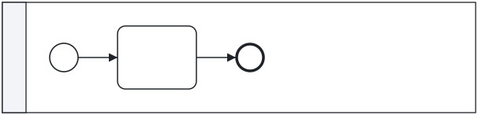 | pool | Participant (pool) with a process | `pool ID "Label" (block)` | executed |
| 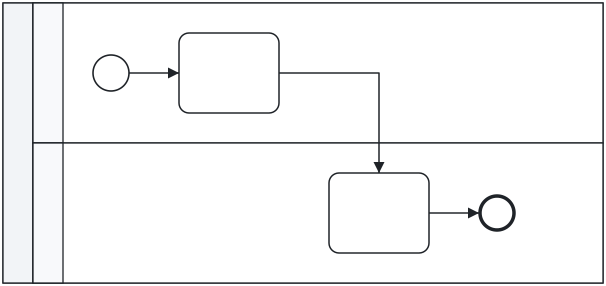 | pool with two lanes | Lane | `lane ID "Label"` | executed |
| 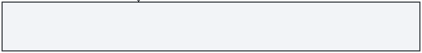 | black-box pool | Participant without a process (black-box pool) | `pool ID "Label" (no block)` | modelling only |
| 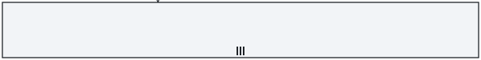 | pool with participant multiplicity | Participant multiplicity | `pool ID "Label" min=2 max=5` | not executed (C123) |

## Conversations

| Symbol | Element | BPMN | tok | Camunda 8 |
|---|---|---|---|---|
|  | conversation | Conversation | `conversation ID "Label" pools="P Q"` | not executed (C120) |
|  | sub-conversation | SubConversation | `subconversation ID "Label" pools="P Q" (block)` | not executed (C120) |
|  | call conversation | CallConversation | `callconversation ID "Label" pools="P Q" collaboration=ID` | not executed (C121) |
|  | conversation link | ConversationLink | `pools= of a conversation` | not executed (C120) |

## Choreographies

| Symbol | Element | BPMN | tok | Camunda 8 |
|---|---|---|---|---|
|  | choreography task | ChoreographyTask | `choreo ID "Label" from=P to=Q message="M"` | not executed (C122) |
| 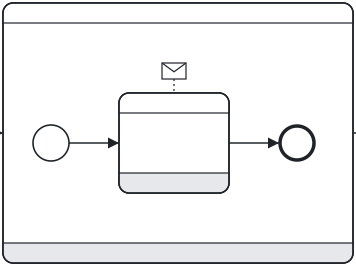 | sub-choreography | SubChoreography | `subchoreo ID "Label" pools="P Q" from=P (block)` | not executed (C122) |
| 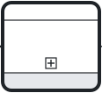 | call choreography | CallChoreography | `callchoreo ID "Label" pools="P Q" from=P choreography=ID` | not executed (C122) |

